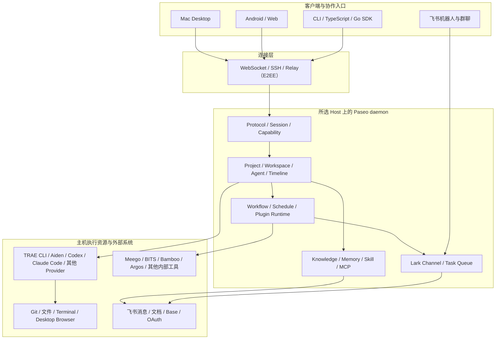

# Paseo 字节版

**把 AI 工具、开发机、项目知识和日常流程，放进同一个工作台。**

你可能已经在用 TRAE CLI、Aiden、Claude Code 或 Codex。Paseo 字节版让你在一个界面里使用这些工具，把项目代码、业务文档和常用助手放在一起，再把适合自动处理的工作接到飞书上。

开发机上的任务跑到哪了？这条对账报警有没有人排查？同事问过的问题，能不能用项目资料先回答？你可以在这里查看进度、补充要求、检查结果，而不用来回找终端、翻群消息、复制上下文。

本版本基于开源 [Paseo](../../README.md) 扩展，面向字节工作环境。它保留官方版的多模型、多设备、代码审查和本机运行能力，进一步补齐项目知识与记忆、助手团队、可视化工作流、飞书协作和字节业务插件。官方版也已提供 TRAE CLI 的 ACP 接入；字节版的价值在于把这些能力接成日常工作流程，而不只是多一个模型入口。

本文介绍本分支的主要功能，不代表开源官方安装包包含这些扩展。想先判断是否适合自己，可以直接看[平台对比与选型](./platform-comparison.md)：那里按相同维度比较官方 Paseo、Botmux、TRAE、AIME 和 Codex，并给出核对依据。

## 一、哪些工作可以交给它

### 主要功能一览

下面既包含继承自官方 Paseo 的基础能力，也包含字节版扩展，不把共有功能算作独家能力。功能是否可用还取决于所选主机、Provider、插件和授权状态。

几个词可以这样理解：**主机**是实际干活的机器；**Project**把相关代码、资料和配置组织在一起；**Provider**是底层执行工具，例如 TRAE CLI 或 Codex；**Workflow**是一套可以重复执行的步骤。Skill 提供操作指引，MCP 用于连接外部工具。

#### AI 编程与开发机管理

| 主要功能            | 用起来有什么价值                                                                                                                           |
| ------------------- | ------------------------------------------------------------------------------------------------------------------------------------------ |
| 多 Provider、多模型 | 统一使用 TRAE CLI、Aiden Claude / Codex、Claude Code、Codex 等工具；按任务选择模型、权限和支持的思考选项，不必所有工作都绑定同一套 AI 工具 |
| 多主机与多端连接    | 连接本机和开发机，在桌面、Web、手机或 CLI 查看和推进工作；可以使用直连或 Relay，插件项目也按所属主机管理                                   |
| Project 与多仓库    | 一个 Project 配置多个项目目录、知识目录和变量，支持项目层级；Git 来源可指定仓库和分支，在任务前同步到项目管理的目录                        |
| 并行工作与代码审查  | 使用工作区、分屏和 Git worktree 隔离并行改动；查看文件、终端、Diff 和 PR，多仓库的改动按仓库分组                                           |
| 会话与指令队列      | 查看历史、任务摘要、执行过程和命令时间；后续指令可排队、调整顺序、编辑、删除或立即引导，工作区支持批量归档与删除                           |
| 浏览器验证与语音    | 启用浏览器工具后，AI 可在桌面内置浏览器里打开页面、点击、填写和截图，验证自己的修改；也可通过语音下达任务                                  |

#### 可复用的项目知识与 AI 团队

| 主要功能            | 用起来有什么价值                                                                                         |
| ------------------- | -------------------------------------------------------------------------------------------------------- |
| 助手与团队          | 把角色、提示词和常用能力保存成助手，再组合成团队；为开发、排查或审核选择合适的执行角色                   |
| Skill 与 MCP 管理   | 统一管理可复用的操作指引和外部工具，选择本次工作需要的能力，不必在每个新会话重新拼配置                   |
| 全局与 Project 知识 | 维护通用资料、规范和项目专有知识；接入本地文件、目录、Git 来源、飞书文档和群上下文，支持索引、缓存与刷新 |
| 分层记忆            | 按全局、Project、助手管理长期经验和偏好，查看、编辑、删除记忆，控制学习范围，并按选定范围在主机间同步    |

#### 自动化与字节业务

| 主要功能                | 用起来有什么价值                                                                                                                 |
| ----------------------- | -------------------------------------------------------------------------------------------------------------------------------- |
| 计划与定时任务          | 按计划启动任务，或定时回到已有会话继续跟进；适合巡检、报告和持续检查，不必每次手动发送相同指令                                   |
| 可视化 Workflow         | 用图编辑和连接 Bash、Python、Agent、条件分支和循环，配置变量、并发、重试及结束条件；查看节点输入输出、日志和耗时，支持预演与取消 |
| 字节研发插件            | 将 PRD / Meego 需求、技术方案、开发、Review、部署、测试和发布串成分阶段流程；实际部署与发布仍受审批和平台门禁约束                |
| 字节对账开发插件        | 对话生成或修改对账代码、SQL 和规则草稿，衔接 FundEye / Fullink / TCheck 的测试与只读比对；规则写入和调试分别控制授权             |
| Bamboo / Argos 自动排查 | 监听与补偿扫描报警，入表去重、排队、独立排查和审核、整理 SOP、发布报告；保留执行记录，支持手动扫描、重试和按配置归档             |

#### 飞书协作与应用扩展

| 主要功能            | 用起来有什么价值                                                                                                                         |
| ------------------- | ---------------------------------------------------------------------------------------------------------------------------------------- |
| 飞书机器人与授权    | 配置多个机器人并绑定 Project，承接私聊和群话题；申请应用时提交所需权限配置，缺少授权时提供对应处理入口                                   |
| 替身模式            | 按用户 / 群及问题规则筛选消息，合并连续提问后回答；私聊先生成答案再转发，每个替身有独立任务列表，也能通过绑定会话的 Skill / CLI 再次回复 |
| 飞书提醒与通讯录    | 配置定时提醒；搜索用户与群，解析 `open_id`，扫描指定时间段的私聊联系人，创建、补全和批量管理通讯录                                       |
| 插件与网页应用      | 安装、启停和管理插件；按 Project 保存配置和记录，也可让 AI 生成声明式操作界面并预览，常用能力不必都写进主界面                            |
| Workflow HTTP 服务  | 把流程变成可调用的异步接口，配置监听地址、端口、路由和输入输出映射；提交后查询状态，在页面查看请求、测试和清理记录                       |
| CLI、SDK 与桌面体验 | 通过 CLI、TypeScript / Go SDK 接入自己的脚本和系统；提供中文界面、主机外观、独立窗体名称及 macOS 灵动岛等桌面能力                        |

“支持”不代表已自动开启：浏览器需要桌面端与相应工具授权，记忆需要启用策略，飞书需要权限，业务插件需要可用的内部工具。下面用常见工作说明如何把这些能力组合起来。

### 写代码：让 AI 带着项目资料开工

一个需求涉及几个代码仓库，还要参考飞书技术方案。你不必每次新开会话，都从头解释代码在哪、业务规则是什么。

在 Project 中配置项目目录、知识目录和参考文档，再选一个已经登录的模型工具，就可以这样开始：

> 结合项目里的技术方案，找出退款状态更新涉及的代码，先给我修改计划，不要直接改文件。

确认方向后，再让它实现和测试。你可以在同一个工作区查看会话、终端和文件改动，多仓库的差异按仓库分组，方便逐项检查。

常用提示词、技能和助手也可以复用。比如为结算项目配置一个熟悉业务约束的助手，下次遇到类似需求时继续使用，不必重新拼一套说明。

做前端修改时，还可以让 AI 打开桌面内置浏览器实际点一遍表单；做跨仓修改时，在不同仓库的 Diff 中检查结果。浏览器、终端和代码变化都围绕当前工作区展开。

**你少做的是找资料、贴背景和切窗口，更多时间留给判断方案、检查代码。**

### 管开发机：不用守着每一个终端

Mac 上在改代码，Linux 开发机上在跑测试，还有一个排查任务没结束。Paseo 可以连接多台主机，让你在同一个界面切换工作区、查看任务进展和继续对话。

任务仍在你选择的主机上运行，使用那台机器的代码、工具和权限。创建插件项目时也要选择主机，插件项目列表跟随工作区的主机筛选，便于区分本机和开发机上的工作。

前一条指令还没执行完时，后续指令可以先排队；需要时再编辑、删除，或立即引导当前任务。你不用等一次回答结束，才想起刚才要补充什么。

**你少做的是反复登录机器、寻找会话和确认“这件事到底跑在哪”。**

### 沉淀经验：把“上次讲过的要求”变成可复用的资料

项目知识用于说明业务背景和规范，记忆用于保存经过确认的经验和偏好，Skill 用于描述一类事情应该怎样做。把它们分开管理，比把所有内容塞进一段越来越长的提示词更容易维护。

例如，团队的对账规范放进 Project 知识；“这类异常要先核对哪几个字段”保存成 Skill；已经确认的项目约定放到项目记忆。再为排查和审核配置不同的助手，减少每次从头安排角色和解释流程的工作。

记忆可以查看、修改、删除，并按范围同步到另一台主机。它不会因为记录了信息就保证判断正确，也不应保存密钥或把临时猜测当成业务事实。

**你少做的是重复培训 AI；积累下来的资料、流程和经验可以继续服务后面的任务。**

### 固化流程：把反复对话变成可以检查和复用的步骤

有些工作不应该每次都让 AI 重新决定顺序。例如“取数 → 分析 → 审核 → 生成报告”：取数和文件处理适合脚本，判断和解释交给 AI，是否继续则由明确的条件控制。

用 Workflow 把这些步骤连起来，保存输入参数和结束条件。失败时查看出错节点的日志和产物，避免只得到一句“执行失败”。需要定期运行时配置计划，需要其他系统调用时用 HTTP 服务插件提供接口，需要操作页面时再接上网页应用。

字节研发和对账开发插件提供了更具体的起点：

- **研发流程：** 从需求和方案开始，推进到开发、Review、部署与测试；发布前仍要完成相应确认和平台检查。
- **对账开发：** 围绕规则设计、代码或 SQL 修改、草稿、测试和差异比对展开；不会把“生成规则”直接等同于“发布到生产”。

**你少做的是每次盯着 AI 走流程；可以复用一套能看懂、能调试、能逐步改进的执行步骤。**

### 飞书协作：把熟悉项目的助手带到群里

飞书机器人可以绑定 Project，让同事通过飞书与对应的 AI 助手交流。项目里的知识和工具也能用于这些会话。

如果你经常被重复的问题打断，可以进一步配置替身模式：

- **群聊：** 处理 @ 授权用户、且符合名单和问题规则的消息，以机器人身份在话题中回答。
- **私聊：** 扫描授权用户尚未回复、且符合规则的消息。先判断是否需要回答并生成答案，再转发到包含相关用户和机器人的群聊，在话题中回复。
- **回答范围：** 可以限制哪些群、哪些人、哪些问题可以处理，以及在哪些时段启用。连续消息可以合并等待，避免对方还没说完就抢答。
- **后续处理：** 每个替身都有自己的任务列表，便于查看失败原因、手动扫描或重试。

如果你在对应会话中优化了答案，可以让 Agent 使用替身项目提供的回复能力，再发到原话题，而不只是生成一份新的文字。允许机器人触发时还会检查自身消息和往返次数，减少相互回复形成循环的风险。

还有飞书定时提醒和通讯录：按配置的时间发送提醒，从通讯录搜索联系人，减少每次查找用户 ID 的麻烦。

**你少做的是重复解答和手动催办；回复范围由你配置，并非默认替你回复所有消息。**

### 报警排查：从“群里有一张卡片”到“有记录、有结论”

Bamboo 对账报警和 Argos 报警都可以配置自动排查项目。你指定飞书机器人、监听群、排查步骤文档（SOP）、归因记录根目录，以及使用的模型。

后续流程由系统衔接：

1. **发现报警：** 实时监听群消息，再按设定的时间范围定时扫描，补查可能遗漏的消息；不匹配的消息直接忽略。
2. **登记排队：** 将匹配报警写入自动创建或复用的日报多维表格，按唯一标识去重，再进入本地处理队列。
3. **分工排查：** 排查、审核、SOP 整理使用独立的 AI 会话，避免把第一次判断直接当成最终结论。表格更新、文档发布等步骤由流程代码负责。
4. **查看结果：** 在任务执行记录中查看状态、报告和失败原因。临时故障按配置间隔有限重试；权限不足等问题保留错误，等待处理，不靠无限重试碰运气。

Bamboo 插件衔接 `life-settle-ai-assistant` 的对账排查能力；Argos 插件使用对应的报警排查流程。它们都需要实际可访问的业务工具、数据和文档，不能保证每条报警都能自动定位根因。

调试时，可以分别关闭监听、扫描或排查，手动指定扫描范围；Bamboo 还支持指定 `result_id` 发起排查，不必为了验证一次配置等待下一轮报警。

**你少做的是从群里收集报警、重复登记和追问进度，能够更快看到哪些已有结论、哪些需要人介入。**

## 二、与官方 Paseo、Botmux、TRAE、AIME、Codex 怎么选

这些产品都不只是聊天窗口。官方 Paseo 已有多 Provider 和多端编排，Botmux 已有多机器人和工作流，TRAE 已有跨端、远程和 Agent 工作区，AIME 已有本地 / 云端协同与应用生态，Codex 也有代码执行、插件和定时任务。**字节版值得选的地方，是它更贴合哪一段工作，而不是其他平台“什么都没有”。**

| 平台           | 它已经擅长什么                                                                                             | 什么时候值得再用 Paseo 字节版                                                                                         |
| -------------- | ---------------------------------------------------------------------------------------------------------- | --------------------------------------------------------------------------------------------------------------------- |
| **官方 Paseo** | 通用多 Provider 工作台，多端、自托管、worktree、Diff、浏览器、调度、插件和编排；也能接 TRAE CLI            | 你需要现成的飞书替身、通讯录、业务排查插件，以及统一的项目知识、分层记忆和图形化 Workflow，而不想从扩展接口逐项接起来 |
| **Botmux**     | 飞书驱动 CLI，流式卡片、可交互 Web 终端、tmux 常驻、多 Bot 协作、Oncall 和可复用工作流                     | 你的主场还包括桌面代码审查、多个开发机、Project 资源和业务插件页面，希望在一个工作台管理它们，而不仅围绕飞书话题操作  |
| **TRAE**       | IDE / Agent 工作区、代码补全与调试、远程和跨端任务、多模型、自定义 Agent 与 MCP；CLI 提供脚本化与 ACP 接入 | 你想保留 TRAE CLI，同时使用 Claude Code、Codex、Aiden 等不同执行工具，并让它们参与同一套项目和业务流程                |
| **AIME**       | 内部平台与知识接入、个人 / 团队助理、飞书、本地与云端协同、记忆、定时任务和 Aime App                       | 你更希望自己管理执行主机、CLI 环境、脚本步骤和任务队列，并直接使用本仓库的 Bamboo / Argos、对账开发等可修改插件       |
| **Codex**      | 官方 App / CLI 的代码理解、修改、Review、并行任务、插件、MCP、浏览器及定时工作                             | 你需要把 Codex 与其他 Provider 放在一起，复用 Project 知识和工作流，并衔接字节内场的飞书与业务系统                    |

### 字节版的四个实际优势

1. **工具可以一起用，不必先迁移习惯。** 保留熟悉的 TRAE CLI、Aiden 或 Codex，为不同任务选合适的工具。多个模型不等于多套执行工具，字节版同时管理后者。
2. **代码、资料、记忆和角色围绕 Project 组织。** 开发、飞书问答和报警排查可以绑定同一个 Project，减少分散配置。
3. **固定步骤写清楚，需要判断的地方再用 AI。** Workflow 和业务插件把脚本、条件、重试、产物校验接起来，便于定位“到底哪一步出了错”。
4. **已有字节业务的起步方案。** 飞书替身、Bamboo / Argos 排查、研发与对账开发不是只提供一个 API 名称，而是有配置页面、执行流程和记录入口；仍需完成权限与业务工具配置。

### 哪些情况下不用急着切换

如果你最看重 IDE 补全和调试，TRAE 的原生开发体验更直接；如果主要在飞书接管终端，Botmux 很贴合；如果更需要免维护的云端助理和广泛内场工具，AIME 有优势；如果工作已经围绕 Codex 建立，官方 App / CLI 能减少一层适配。

字节版需要自己维护主机、工具和授权，不能替代云端托管服务，也不能承诺比同一底层模型更快、更聪明或更便宜。模型额度和模型服务排队仍由 Provider 决定。

详细能力矩阵、版本范围、适用边界及来源见[平台对比与选型](./platform-comparison.md)。这些能力可以逐步使用：先接一个现有项目，再加飞书或自动化，**不用一开始就配置完所有功能。**

Paseo 不替你购买模型，也不绕过内部系统权限。模型额度、网络访问和业务操作权限，仍由你选用的工具、账户及执行主机决定。

## 三、架构设计

### 一句话理解

Paseo 字节版采用“**多客户端连接 Host daemon，daemon 统一管理 Project、Agent 和自动化流程，再调用主机上的 Provider 与业务工具**”的架构。

Mac、Android、Web、CLI 和飞书只是不同入口；真正执行代码、保存项目状态、运行 Workflow 和处理插件任务的是所选主机上的 daemon。这样既能在不同设备继续同一项工作，又不会把“界面在哪里”和“代码在哪里执行”混在一起。



### 核心模块

| 模块               | 主要职责                                                                           | 对使用者的价值                                                                        |
| ------------------ | ---------------------------------------------------------------------------------- | ------------------------------------------------------------------------------------- |
| 客户端与协作入口   | Mac、Android、Web、CLI、SDK 和飞书提供不同操作入口                                 | 在桌面深度开发、手机查看进度、终端自动化或群聊协作时，继续使用同一个 Host 上的任务    |
| 连接层             | 使用本地连接、SSH、直连或 Relay 把客户端连接到 daemon                              | 远程开发机不需要直接暴露公网端口；Relay 传输使用端到端加密                            |
| daemon 控制层      | 负责身份握手、能力协商、Project / Workspace / Agent 生命周期、权限请求和时间线     | daemon 是主机上的唯一事实源，多个客户端看到的是同一份任务状态，不依赖某个界面一直打开 |
| Project 与上下文层 | 管理项目目录、知识、记忆、助手、Skill、MCP 和飞书文档缓存                          | 代码、业务资料、角色与长期经验围绕 Project 组织，不用在每个会话重新准备               |
| Provider 执行层    | 通过统一适配器启动 TRAE CLI、Aiden、Codex 等执行工具，并规范化消息、工具调用和权限 | 上层流程不用绑定单一模型工具，可以按任务更换 Provider                                 |
| 自动化与插件层     | 运行 Workflow、Schedule、插件进程、HTTP 服务、飞书任务队列和报警排查               | 把脚本、AI 判断、定时触发、记录和业务系统连接成可回看、可重试的流程                   |
| 持久化层           | 将配置、Project、Agent 时间线、Workflow、插件记录和任务状态保存到 `$PASEO_HOME`    | 客户端断开后任务仍可由 daemon 管理，重连后继续查看；不同 Host 的状态彼此隔离          |

### 一条任务怎样流转

1. **选择执行位置。** 客户端先选择 Host、Project、Workspace、Provider、模型和权限模式。
2. **组装上下文。** daemon 根据 Project 读取项目目录、知识、记忆、助手、Skill 和 MCP 配置，只加入当前任务允许访问的内容。
3. **创建 Agent Session。** Provider 适配器在所选 Host 启动或恢复真实执行工具；代码和终端命令都在该 Host 上运行。
4. **持续回传过程。** Provider 的回答、思考摘要、工具调用、权限请求和命令状态被转换成统一事件，写入时间线并广播给已连接客户端。
5. **人工继续控制。** 用户可以在 Mac、Android、Web 或 CLI 查看同一进度，处理权限、追加指令、排队、停止或归档。
6. **自动化继续处理。** 如果任务来自 Workflow、飞书替身或报警插件，daemon 还会更新本地队列、飞书消息、多维表格和执行记录，并按规则重试或等待人工处理。

### 三种常见部署方式

| 部署方式       | 连接关系                                                   | 适合场景                                                                         |
| -------------- | ---------------------------------------------------------- | -------------------------------------------------------------------------------- |
| Mac 单机       | Mac Desktop → 内置 daemon → Mac 上的代码和 Provider        | 个人开发、前端浏览器验证、无需长期在线的任务                                     |
| Linux 远程执行 | Mac / Android → SSH、Relay 或 Tailscale → Linux CLI daemon | 使用开发机代码、公司网络和长期运行环境；关闭客户端后 daemon 继续工作             |
| 多 Host 协作   | 一个客户端同时连接 Mac 与多台 Linux daemon                 | 不同项目分布在不同机器，或需要分别使用本地浏览器、开发机算力和不同 Provider 配置 |

每个 Host 都有独立的 `$PASEO_HOME`、Provider 环境、Project 和插件数据。客户端可以统一展示多个 Host，但不会悄悄把一个 Host 的文件路径、凭据或运行任务搬到另一个 Host。

### 安全与权限边界

- **代码执行边界：** Agent、Terminal、Workflow 和插件都在所选 Host 上执行。Android 只是客户端，不在手机上运行代码。
- **模型数据边界：** 代码文件默认留在 Host，但任务提示词、选中的上下文和工具结果可能发送给所选 Provider。使用内部资料前仍要遵守对应模型和数据规范。
- **传输边界：** 本地和 SSH 连接不经过 Relay；启用 Relay 时，客户端与 daemon 使用端到端加密，配对链接是访问凭据。
- **权限边界：** Provider 权限、Paseo 操作权限、飞书机器人应用权限和飞书用户 OAuth 是不同层级，任一层缺失都不能由其他层自动绕过。
- **插件边界：** 插件是受信任代码，不是天然隔离的沙箱；只安装可信插件，并为 Workflow 和业务写操作保留审批或 dry-run。
- **状态边界：** daemon 保存权威状态，客户端缓存只用于快速显示；重连后以 daemon 返回结果为准。

### 为什么采用这种架构

这种设计不是为了在每一项单点能力上替代 TRAE、AIME、Botmux 或 Codex，而是让它们能够参与同一套主机、项目和流程：

- **界面与执行分离：** 手机可以控制开发机，但不会把开发环境搬到手机。
- **Provider 与流程分离：** 更换底层模型工具时，Project、Workflow 和业务记录不必跟着重建。
- **通用底座与业务插件分离：** daemon 管 Agent、权限和状态；插件只负责自己的配置、队列和业务适配。
- **实时交互与持久任务分离：** WebSocket 负责即时过程，持久化时间线和任务存储负责断线恢复与审计。

更详细的包结构、协议、Agent 生命周期和存储说明见[架构文档](https://github.com/ycwpub/paseo/blob/feature_paseo/docs/product-extensions/architecture.md)。

## 四、怎么开始用

### 从 GitHub 获取 Paseo 字节版源码

Paseo 字节版源码位于：

- GitHub：<https://github.com/ycwpub/paseo>
- 分支：[`feature_paseo`](https://github.com/ycwpub/paseo/tree/feature_paseo)

请显式下载 `feature_paseo` 分支，不要直接使用默认分支，也不要用官方 Paseo Release、公共 npm 包或 Docker 镜像代替字节版：

```bash
git clone --branch feature_paseo --single-branch https://github.com/ycwpub/paseo.git
cd paseo
git branch --show-current
```

最后一条命令应输出：

```text
feature_paseo
```

仓库通过 `.tool-versions` 固定 Node.js `22.20.0`。已经使用 [mise](https://mise.jdx.dev) 的用户可以执行 `mise install`；否则请先安装兼容的 Node.js 22 和 npm。所有平台都先在仓库根目录安装依赖：

```bash
npm ci
```

源码构建会使用当前 checkout 的内容。以后拉取更新时，先确认没有未提交改动，再执行：

```bash
git switch feature_paseo
git pull --ff-only origin feature_paseo
npm ci
```

### 安装、配置和使用 Mac 版

#### 1. 构建

Apple Silicon Mac 使用：

```bash
npm run build:desktop -- --publish never --mac --arm64
```

Intel Mac 将最后一个参数改为 `--x64`：

```bash
npm run build:desktop -- --publish never --mac --x64
```

构建会先编译网页客户端、daemon 和 CLI，再生成桌面安装包。产物位于：

```text
packages/desktop/release/
```

常见产物包括：

```text
Paseo-<版本>-arm64.dmg
Paseo-<版本>-arm64.zip
mac-arm64/Paseo.app
```

Intel 构建的目录和文件名使用 `x64`。不要在同一个 checkout 中同时启动正式版和开发版 daemon；正式桌面版默认使用 `~/.paseo` 和 `127.0.0.1:6767`。

#### 2. 安装

打开生成的 `.dmg`，把 **Paseo.app** 拖入 `/Applications`，然后从“应用程序”启动。源码本地构建可能没有 Apple 公证；确认源码和产物可信后，可在 macOS“系统设置 → 隐私与安全性”中选择“仍要打开”。

桌面 App 会自动启动内置 daemon，不需要另外安装 server。打开 **设置 → 本地主机 → 概览**，确认主机在线；需要退出 App 后继续运行任务时，再开启“退出后保持 daemon 运行”。

#### 3. 配置

1. 在执行任务的 Mac 上安装并登录要使用的 Provider，例如 TRAE CLI、Aiden、Codex 或 Claude Code。
2. 打开 **设置 → 本地主机 → Providers**，添加或启用 Provider，刷新模型，并使用“诊断”确认 Paseo daemon 能找到实际命令。
3. 创建或选择 Project，添加项目目录、知识目录和需要的飞书文档；再创建工作区。
4. 需要管理 Linux 开发机时，打开 **设置 → 添加主机 → Remote SSH**，填写 `ssh://用户@主机`。远端必须已安装并启动 Linux CLI daemon。
5. 需要手机访问本机任务时，在 **设置 → 本地主机 → 配对设备** 中启用 Relay，扫描二维码或复制配对链接。

Provider 必须安装在真正执行任务的主机上。Mac 只作为远程主机的界面时，不需要在 Mac 上重复安装远端 Provider。

#### 4. 使用

进入工作区后，选择 Provider、模型和权限模式，再发送任务。文件、终端、Diff、PR、任务摘要和浏览器可以在同一工作区打开。建议先执行只读任务，再逐步允许修改和命令执行。

### 安装、配置和使用 Android 版

Android App 是客户端，不在手机上运行 coding agent。它需要连接 Mac 桌面版管理的 daemon，或安装了 Linux CLI 的远程主机。

#### 1. 准备 Android 构建环境

Android 构建可以在 macOS 或 Linux 上执行。仓库使用 Java 21 和 Android SDK command-line tools `21.0`。使用 mise 时：

```bash
mise install
sdkmanager --licenses
sdkmanager "platform-tools" "platforms;android-35" "build-tools;35.0.0"
```

在 Android 手机中开启“开发者选项”和“USB 调试”，连接电脑后确认：

```bash
adb devices
```

#### 2. 直接构建并安装到已连接设备

在仓库根目录执行：

```bash
npm run android:production
```

该命令会生成 Android 原生工程、构建 production variant，并安装到当前连接的设备或模拟器。包名是 `sh.paseo`。

#### 3. 只生成 APK，再手动安装

如果需要先生成 APK，再复制到其他 Android 设备：

```bash
npm run build:client
cd packages/app
APP_VARIANT=production npx expo prebuild --platform android --clean --non-interactive
cd android
./gradlew assembleRelease --no-daemon --max-workers=1 -Dorg.gradle.parallel=false
cd ../../..
```

APK 路径：

```text
packages/app/android/app/build/outputs/apk/release/app-release.apk
```

通过 USB 安装：

```bash
adb install -r packages/app/android/app/build/outputs/apk/release/app-release.apk
```

本地源码构建的 release APK 使用本机生成工程中的测试签名，适合内部体验，不是应用商店正式签名。若设备已经安装同包名、不同签名的 Paseo，`adb install -r` 会失败；卸载旧版会清除该 App 的本地连接配置，请先确认后再操作。

#### 4. 配置连接

在要执行任务的 Mac 或 Linux 主机上生成配对信息：

```bash
paseo daemon pair
```

按提示启用 Relay 后，Android App 扫描二维码，或选择“粘贴配对链接”。也可以让手机和 daemon 主机加入同一个 Tailscale 网络，再添加直接连接。

Provider、模型、Project、插件和飞书机器人保存在 daemon 主机，不保存在 Android 手机上。Android 连接成功后会读取该主机的现有配置。

#### 5. 使用

Android 端适合查看 Agent 进度、继续对话、处理授权、浏览文件、使用终端和检查 Diff。桌面内置浏览器仍由 Mac 桌面 App 承载；仅连接 Android 客户端时，依赖桌面浏览器的工具不可用。

### 安装、配置和使用 Linux CLI 版

Linux CLI 同时包含 `paseo` 命令和 daemon。它适合安装在开发机或长期在线的 Linux 主机上，再由 Mac 和 Android 连接。

#### 1. 构建并安装

在 Linux 上下载 `feature_paseo` 分支并执行 `npm ci` 后，在仓库根目录运行：

```bash
npm pack --workspace=@getpaseo/cli
npm install -g ./getpaseo-cli-*.tgz
```

`npm pack` 会先构建 protocol、client、server 和 CLI，并把运行所需的 Paseo workspace 包打入 tarball，因此耗时会明显长于普通 TypeScript 编译。安装后确认：

```bash
paseo --version
command -v paseo
```

#### 2. 启动和检查 daemon

```bash
paseo daemon start
paseo daemon status --json
```

默认数据目录是 `~/.paseo`，默认监听 `127.0.0.1:6767`。不要直接把该端口暴露到公网；远程连接优先使用 SSH、Relay 或 Tailscale。

#### 3. 配置 Provider 和 Project

1. 在 Linux 主机安装并登录实际使用的 CLI，例如 `traecli`、`codex` 或其他 Provider。
2. 使用诊断确认 daemon 的运行环境能找到命令：

   ```bash
   paseo provider diagnostic traecli
   ```

3. 可以从 Mac 桌面版通过 **Remote SSH** 连接这台 Linux 主机，再用图形界面配置 Provider、模型、Project、知识和插件。
4. 也可以直接编辑 `~/.paseo/config.json`；修改后运行 `paseo reload`，命令会说明哪些配置已生效、哪些需要重启。
5. 在代码目录创建 Project：

   ```bash
   cd /srv/your-project
   paseo project create
   paseo project ls
   ```

#### 4. 配对 Android 或其他客户端

```bash
paseo daemon pair
```

确认启用 Relay 后，扫描或粘贴配对链接。配对链接等同于访问凭据，不要发到公开群聊或文档。

Mac 桌面版也可通过 SSH 直接连接，无需打开 Linux daemon 的公网端口：

```text
ssh://用户@Linux主机
```

#### 5. 使用 CLI

在项目目录启动 Agent：

```bash
paseo run --provider traecli "先阅读项目结构和测试命令，不要修改文件"
```

常用命令：

```bash
paseo ls -a
paseo attach <agent-id>
paseo send <agent-id> "继续补充定向测试"
paseo logs <agent-id>
paseo stop <agent-id>
```

需要后台执行时给 `paseo run` 增加 `--background`。模型、权限模式和工作区隔离可继续通过对应参数或 Mac 桌面界面选择。

### 三端如何配合

推荐把 Linux 开发机作为长期在线的执行主机，Mac 作为主要开发和配置界面，Android 用于移动查看和处理授权：

```text
Mac / Android 客户端
        │
        ├── 连接 Mac 内置 daemon → 使用 Mac 上的代码和 Provider
        │
        └── 连接 Linux CLI daemon → 使用 Linux 开发机上的代码和 Provider
```

同一项任务只在其所属 daemon 主机上执行。客户端关闭后，独立启动的 Linux daemon 仍可继续运行；Mac 桌面内置 daemon 是否继续运行取决于“退出后保持 daemon 运行”设置。

### 第一次使用前的共同准备

只体验 AI 编程，不需要先申请飞书机器人。至少准备：

- 一个已经安装并登录的 Provider；
- 一个该主机可访问的代码目录；
- 一台在线的 daemon 主机；
- 一个已连接到该主机的 Mac、Android 或 CLI 客户端。

尽量让客户端和 daemon 来自同一个 `feature_paseo` 提交。版本差异过大时，部分入口会要求更新主机。

### 第一次体验：先让它完成一件看得懂的小事

1. **连接主机。** 打开字节版桌面 App，确认本机在线；使用开发机时，先运行该主机的服务端，再按[连接说明](../../public-docs/connectivity.md)添加主机。
2. **选好模型。** 在所选主机的 Provider 设置中添加或启用 TRAE CLI、Aiden 等已经安装的工具，刷新模型列表。需要自定义启动命令或环境变量时，参考[Provider 配置说明](../custom-providers.md)。模型列表以该主机的工具实际返回结果为准。
3. **创建工作区。** 选择代码目录，并确认任务运行在正确的主机。需要跨仓库处理时，再在 Project 设置中补充项目目录和知识资料。
4. **发一个小任务。** 先试下面的只读请求，观察它是否能找到代码、解释依据：

   > 看一下这个项目的目录结构，告诉我启动入口、测试命令和最值得先读的三个文件。先不要修改任何文件。

5. **检查后再加深使用。** 确认它读到了正确项目，再尝试修复一个小问题或补一条测试，在文件差异中检查结果。常用的业务说明可以保存到 Project，常用角色可以配置成助手。

### 再接飞书：从一个测试群开始

在运行任务的主机设置中打开“渠道”，添加或申请飞书机器人，绑定已有 Project，或创建一个同名的新 Project。

通过 Paseo 申请机器人时，会提交已登记功能所需的应用权限和事件配置，但**提交申请不等于权限已经生效**。飞书管理员审批、应用发布、文档可见范围，以及具体用户的 OAuth 授权，都需要按页面提示完成。

建议先在测试群验证普通消息交互，再开替身或定时提醒。配置替身时，先限定用户和群白名单、问题范围和启用时段；用户白名单为空时不处理私聊，群白名单为空时不处理群聊。

需要读取云文档时，按页面给出的授权链接完成授权。模型登录、机器人应用权限、用户授权和文档访问范围是不同的事情，某一项成功不代表其他项也已就绪。

### 再接报警：先跑通一条，再开启自动处理

打开“插件”中的 **Bamboo 对账自动排查** 或 **Argos 报警自动排查**：

1. 新建插件项目，选择主机、已有或新建的 Project，以及 Provider 和具体模型。
2. 配置机器人、监听群、排查 SOP 文档和归因记录根目录。使用该主机上可用的业务工具，并确认机器人有相应的群和文档访问权限。Bamboo 也可配置仅供该插件项目使用的专用机器人。
3. 保持项目总开关开启，先关闭群消息监听和定时扫描并保存配置，再手动扫描一小段时间范围，或为 Bamboo 指定一个已知 `result_id`。手动执行会触发实际处理，建议使用测试群和测试记录目录。
4. 到“任务执行记录”检查消息是否入表、排查是否完成、报告能否打开。遇到失败先处理对应的权限、数据或工具问题，再重试。
5. 确认结果符合预期后，再开启需要的监听、定时扫描和排查开关，设置合适的间隔。

持续运行的任务需要执行主机和服务端保持在线。自动排查的结论仍需结合业务证据检查，不能直接当成生产变更或资金操作的授权。

### 使用时记住这三点

- **看清执行主机和权限。** 涉及代码修改、消息发送或业务系统操作时，先确认任务范围，不要为图方便直接放开所有权限。
- **按数据规范使用模型。** 任务在你的主机执行，但输入和工具结果可能发送给所选模型服务；飞书回复、报告发布也会把内容发送到相应系统。处理内部资料前确认允许的使用范围。
- **只安装可信插件。** 插件能够在主机上运行代码，并非天然隔离的沙箱。

**从一个熟悉的代码目录和一个只读问题开始。** 等你不再需要到处找会话、反复贴项目背景，再把那些每天重复发生的问答、提醒和报警处理接进来。
